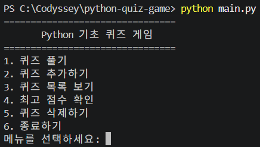
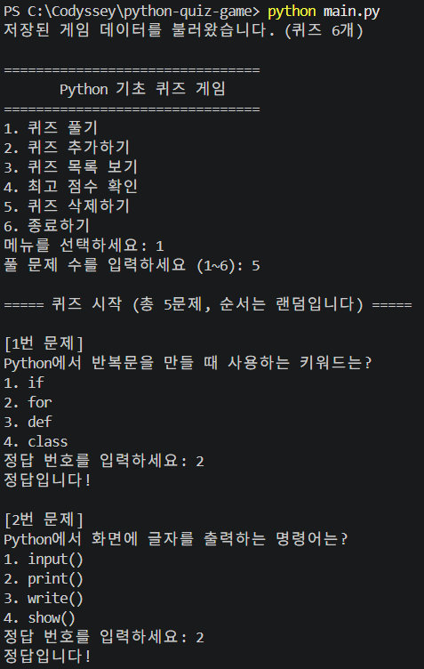
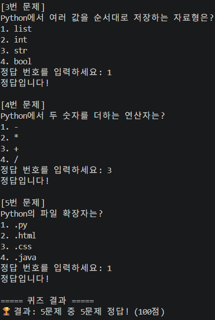
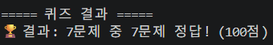
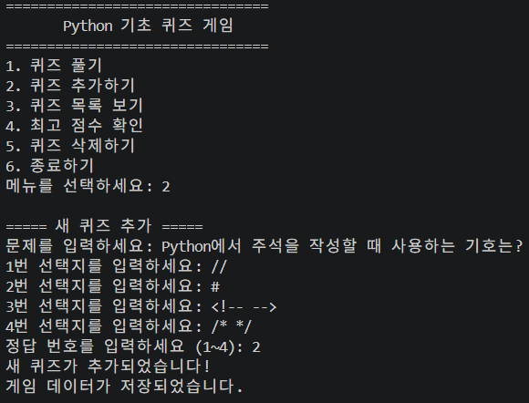
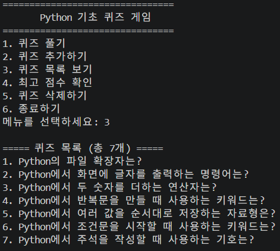
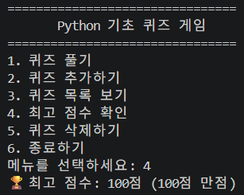
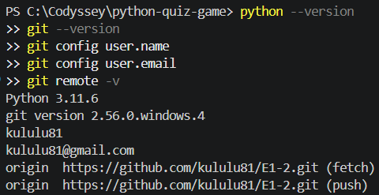
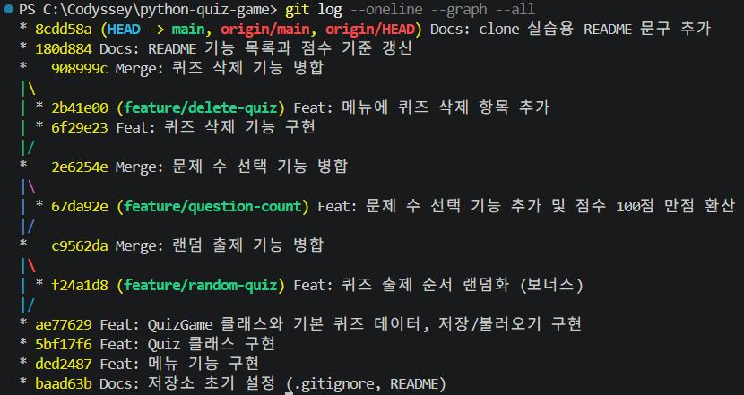
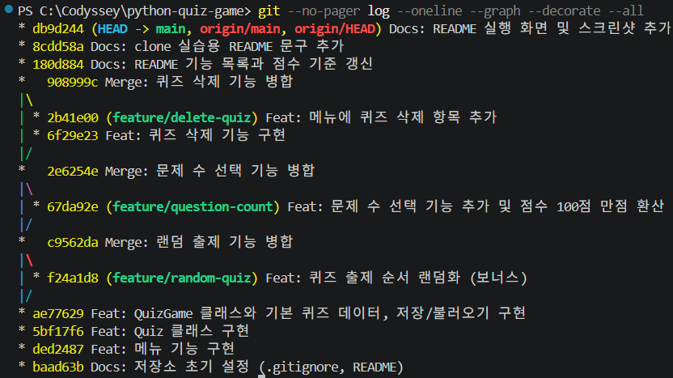

# Python 기초 퀴즈 게임

## 1. 프로젝트 개요

Python 기초 지식을 재미있게 학습할 수 있는 콘솔 기반 퀴즈 게임입니다.

Python 표준 라이브러리만 사용하며, `Quiz`, `QuizGame` 클래스로 역할을 나누고 JSON 파일(`state.json`)에 데이터를 저장합니다. 프로그램을 종료한 후 다시 실행해도 퀴즈와 최고 점수가 유지됩니다.

## 2. 퀴즈 주제와 선정 이유

**주제: Python 기초 문법**

Python을 처음 배우는 학습자가 주요 문법과 개념을 반복해서 확인하고 익힐 수 있도록 퀴즈 형식으로 구성했습니다. 직접 배우고 있는 내용을 문제로 만들면서 복습할 수 있다는 점도 주제 선정 이유입니다.

## 3. 실행 방법

Python 3.10 이상이 필요하며, 외부 라이브러리는 필요하지 않습니다.

```powershell
git clone https://github.com/kululu81/E1-2.git
cd E1-2
python main.py
```

## 4. 기능 목록

| 메뉴 | 기능 | 설명 |
| --- | --- | --- |
| 1 | 퀴즈 풀기 | 풀 문제 수를 선택하면 퀴즈를 랜덤 순서로 출제합니다. 정답과 오답을 알려주고 100점 만점으로 환산한 결과를 보여줍니다. 최고 점수를 넘으면 갱신합니다. |
| 2 | 퀴즈 추가하기 | 문제, 선택지 4개, 정답 번호를 입력받아 새 퀴즈를 등록하고 저장합니다. |
| 3 | 퀴즈 목록 보기 | 등록된 퀴즈를 번호와 함께 보여줍니다. |
| 4 | 최고 점수 확인 | 지금까지의 최고 점수를 보여줍니다. 아직 퀴즈를 풀지 않았다면 안내 메시지를 출력합니다. |
| 5 | 퀴즈 삭제하기 | 번호를 선택하고 확인(y/n)을 거쳐 퀴즈를 삭제한 뒤 저장합니다. |
| 6 | 종료하기 | 데이터를 저장하고 프로그램을 종료합니다. |

### 입력 검증 및 예외 처리

- 공백, 빈 입력, 숫자가 아닌 값, 범위 밖 숫자는 안내 메시지를 출력하고 다시 입력받습니다.
- 퀴즈 등록 시 문제 내용, 선택지 4개, 정답 번호가 유효한지 확인합니다.
- 중복된 선택지는 등록하지 않도록 검증합니다.
- `Ctrl+C`에 의한 `KeyboardInterrupt`나 입력 스트림 종료에 따른 `EOFError`가 발생해도 저장을 시도하고 안전하게 종료합니다.
- `state.json`이 없으면 기본 퀴즈 데이터를 사용합니다.
- 저장 파일이 손상된 경우 백업 파일을 이용한 복구를 시도합니다. 백업도 사용할 수 없으면 기본 데이터로 초기화합니다.

### 보너스 기능

- 퀴즈 랜덤 출제
- 출제할 문제 수 선택
- 퀴즈 삭제

## 5. 파일 구조

```text
.
├── main.py          # 프로그램 실행 및 메뉴 루프
├── quiz.py          # Quiz 클래스 (개별 퀴즈)
├── quiz_game.py     # QuizGame 클래스 (게임 진행 및 데이터 관리)
├── state.json       # 퀴즈 및 최고 점수 데이터
├── README.md
├── .gitignore
└── docs/
    └── screenshots/ # 실행 및 Git 관련 스크린샷
```

`state.json`은 프로그램 실행 중 생성·변경되는 데이터 파일이며 Git 관리 대상에서 제외합니다.

## 6. 데이터 파일 설명 (`state.json`)

- **경로**: 프로젝트 루트의 `state.json`
- **역할**: 사용자가 추가한 퀴즈와 최고 점수를 저장해 프로그램을 다시 실행해도 유지되도록 합니다.
- **인코딩**: UTF-8
- **생성 시점**: 최초 저장 시 자동 생성됩니다. 퀴즈 추가·삭제, 최고 점수 갱신, 프로그램 종료 시 저장합니다.
- 게임 진행에 따라 내용이 바뀌므로 `.gitignore`에 등록해 Git 관리에서 제외했습니다.

| 필드 | 타입 | 설명 |
| --- | --- | --- |
| `quizzes` | 배열 | 퀴즈 목록 |
| `quizzes[].question` | 문자열 | 문제 내용 |
| `quizzes[].choices` | 문자열 배열 | 선택지 4개 |
| `quizzes[].answer` | 정수 | 정답 번호 (1~4) |
| `best_score` | 정수 또는 `null` | 100점 만점으로 환산한 최고 점수. `null`이면 아직 퀴즈를 풀지 않은 상태 |

### 데이터 예시

```json
{
    "quizzes": [
        {
            "question": "Python의 파일 확장자는?",
            "choices": [".py", ".html", ".css", ".java"],
            "answer": 1
        }
    ],
    "best_score": 80
}
```

## 7. 프로그램 구조와 역할 분리

프로그램은 입력과 실행 흐름, 개별 퀴즈, 게임 진행 및 데이터 관리를 구분하도록 설계했습니다.

| 파일 | 주요 역할 | 담당 기능 |
| --- | --- | --- |
| `main.py` | 실행 및 사용자 입력 흐름 제어 | 메뉴 출력, 메뉴 선택, 종료 처리 |
| `quiz.py` | 개별 퀴즈 객체 관리 | 문제와 선택지 검증, 문제 출력, 정답 확인 |
| `quiz_game.py` | 게임 진행 및 데이터 관리 | 퀴즈 출제, 추가·삭제, 점수 관리, JSON 저장·불러오기 |

### 입력 검증과 데이터 입출력의 분리

- `main.py`는 사용자에게 메뉴를 보여주고 입력에 따라 기능을 실행하는 역할을 담당합니다.
- `quiz.py`는 개별 퀴즈의 데이터가 올바른지 검증하고 정답을 확인합니다.
- `quiz_game.py`는 게임 진행과 퀴즈 데이터를 관리합니다.
- `quiz_game.py`의 `_read_data()`, `load_data()`, `save_data()`는 파일 읽기와 저장을 담당합니다.
- `_validate_data()`는 불러온 데이터의 구조와 값이 유효한지 확인합니다.

이처럼 사용자 입력 처리, 데이터 검증, 파일 입출력의 역할을 구분해 기능별 수정과 유지보수가 쉽도록 구성했습니다.

### 객체지향 설계를 선택한 이유

`Quiz`와 `QuizGame` 클래스를 사용한 이유는 각 객체가 담당하는 데이터와 기능을 하나로 묶어 관리하기 위해서입니다.

- **Quiz 클래스**: 하나의 퀴즈에 필요한 문제, 선택지, 정답과 검증 기능을 관리합니다.
- **QuizGame 클래스**: 퀴즈 목록, 게임 진행, 점수, 저장 및 불러오기 기능을 관리합니다.

기능을 함수만으로 구현할 수도 있지만, 퀴즈 데이터와 관련 동작을 객체 단위로 묶으면 역할을 명확하게 구분하고 기능을 재사용하거나 확장하기 쉽다고 판단했습니다.

## 8. 데이터 저장 방식과 확장 가능성

### JSON을 선택한 이유

- Python 표준 라이브러리인 `json` 모듈을 이용할 수 있어 별도의 설치가 필요하지 않습니다.
- 사람이 읽을 수 있는 텍스트 형식으로 데이터를 확인하고 수정하기 쉽습니다.
- 퀴즈와 최고 점수처럼 비교적 단순한 데이터를 파일 하나로 관리하기에 적합합니다.

### JSON 방식의 한계

- 데이터를 저장할 때 파일 전체를 읽거나 다시 쓰는 방식이므로 데이터가 커질수록 처리 비용이 증가할 수 있습니다.
- 여러 사용자가 동시에 데이터를 수정하는 환경에는 적합하지 않습니다.
- 데이터 검색과 복잡한 관계 관리 기능이 제한적입니다.

향후 퀴즈 데이터가 많아지거나 여러 사용자가 이용하는 서비스로 확장한다면 SQLite 또는 PostgreSQL 같은 데이터베이스를 사용하는 방식으로 개선할 수 있습니다.

## 9. 백업 및 복구 전략

데이터 파일이 손상되거나 저장 과정에서 문제가 발생할 가능성에 대비해 백업 및 복구 기능을 구현했습니다.

| 파일 | 역할 |
| --- | --- |
| `state.json` | 현재 게임 데이터 |
| `state.json.bak` | 이전 정상 데이터 백업 |
| `state.json.tmp` | 저장 중 사용하는 임시 파일 |
| `state.json.corrupt` | 손상된 원본 파일 보존 |

### 저장 및 복구 과정

1. 데이터를 임시 파일에 기록합니다.
2. 기존 데이터 파일이 있으면 백업 파일을 생성합니다.
3. 임시 파일을 이용해 현재 데이터 파일을 갱신합니다.
4. 현재 데이터 파일을 읽을 수 없으면 손상된 파일을 별도로 보존합니다.
5. 백업 파일을 읽어 복구를 시도합니다.
6. 백업 파일도 정상적으로 읽을 수 없으면 기본 퀴즈 데이터로 초기화합니다.

### 복구 테스트

정상적인 JSON 파일을 별도로 백업한 뒤 `state.json`을 의도적으로 손상시켜 실행 테스트를 진행했습니다.

- 손상된 파일이 `state.json.corrupt`로 보존되는지 확인했습니다.
- 백업 파일을 이용해 데이터를 복구하는지 확인했습니다.
- 복구 후 `state.json`과 백업 파일이 정상적인 JSON 형식인지 확인했습니다.
- 복구된 퀴즈 7개가 유지되는 것을 확인했습니다.

## 10. Git 버전 관리

### 커밋 관리

기능이나 수정 사항을 논리적인 단위로 나누어 커밋했습니다.

커밋 메시지는 작업 유형과 내용을 구분할 수 있도록 다음 형식을 사용했습니다.

```text
<type>: <summary>
```

사용한 메시지 예시는 다음과 같습니다.

```text
Feat: 랜덤 출제 기능 추가
Fix: 입력 검증 오류 수정
Docs: README 실행 화면 및 스크린샷 추가
```

한 번의 커밋에는 하나의 기능 추가, 오류 수정 또는 문서 변경을 담아 변경 이력을 쉽게 확인할 수 있도록 했습니다.

### 브랜치 전략

기능별로 브랜치를 분리해 작업한 뒤 구현과 테스트를 마치면 `main` 브랜치에 병합했습니다.

| 브랜치 | 작업 내용 | 병합 커밋 |
| --- | --- | --- |
| `feature/random-quiz` | 퀴즈 출제 순서 랜덤화 | `c9562da` |
| `feature/question-count` | 출제 문제 수 선택 및 점수 환산 | `2e6254e` |
| `feature/delete-quiz` | 퀴즈 삭제 기능 구현 | `908999c` |

기능별 브랜치에서 작업하면 기존 코드에 영향을 주지 않고 개발할 수 있으며, 기능이 완성된 후 병합해 변경 사항을 통합할 수 있습니다.

### Git 이력 확인

작성 시점에 총 14개의 커밋을 확인했습니다. 이후 README 보완 및 추가 작업에 따라 커밋 수는 달라질 수 있습니다.

커밋 개수 확인:

```powershell
git rev-list --count HEAD
```

브랜치 확인:

```powershell
git branch -a
```

브랜치 병합 이력 확인:

```powershell
git --no-pager log --oneline --graph --decorate --all
```

### Clone 및 Pull 실습

별도 폴더에 저장소를 clone하고 원격 저장소의 변경 사항을 pull하는 실습을 진행했습니다.

```powershell
git clone https://github.com/kululu81/E1-2.git
cd E1-2
git pull origin main
```

## 11. 요구사항 변경 시 수정 위치

기능을 추가하거나 변경할 때 관련 역할에 맞는 파일과 메서드를 수정하도록 구성했습니다.

| 변경 요구사항 | 수정 파일 | 관련 메서드 또는 위치 |
| --- | --- | --- |
| 메뉴 추가 및 변경 | `main.py` | `print_menu()`, `main()` |
| 퀴즈 데이터 검증 변경 | `quiz.py` | `Quiz.__init__()` |
| 문제 수 선택 방식 변경 | `quiz_game.py` | `_ask_question_count()` |
| 퀴즈 출제 방식 변경 | `quiz_game.py` | `play()` |
| 퀴즈 추가 방식 변경 | `quiz_game.py` | `add_quiz()` |
| 퀴즈 삭제 방식 변경 | `quiz_game.py` | `delete_quiz()` |
| 퀴즈 목록 출력 변경 | `quiz_game.py` | `show_quizzes()` |
| 최고 점수 표시 변경 | `quiz_game.py` | `show_best_score()` |
| 데이터 저장 및 불러오기 변경 | `quiz_game.py` | `save_data()`, `load_data()`, `_read_data()` |
| 데이터 구조 검증 변경 | `quiz_game.py` | `_validate_data()` |

기능별 역할을 나누어 두었기 때문에 변경 범위를 파악하고 필요한 부분을 수정하기 쉽도록 했습니다.

## 12. 실행 화면

### 프로그램 메뉴



### 퀴즈 실행







### 퀴즈 추가 및 목록





### 최고 점수



### 개발 환경 및 Git 이력





### Git 브랜치 병합 그래프



## 13. 프로젝트 마무리

Python 기초 문법을 활용해 콘솔 기반 퀴즈 게임을 구현했습니다.

기능 구현뿐 아니라 클래스별 역할 분리, 입력값 검증, JSON 파일 저장 및 복구, Git 브랜치와 커밋을 통한 버전 관리까지 경험했습니다.

또한 기능별 브랜치 작업과 병합, 별도 폴더에서의 clone 및 pull 실습을 통해 협업 개발의 기본적인 흐름을 익혔습니다.